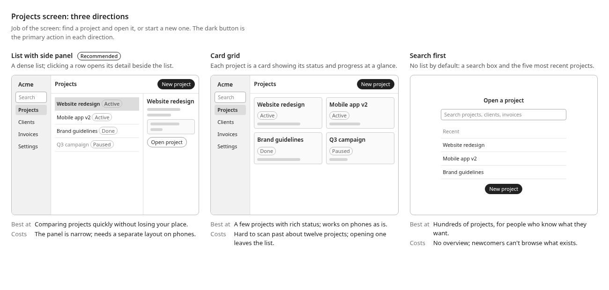
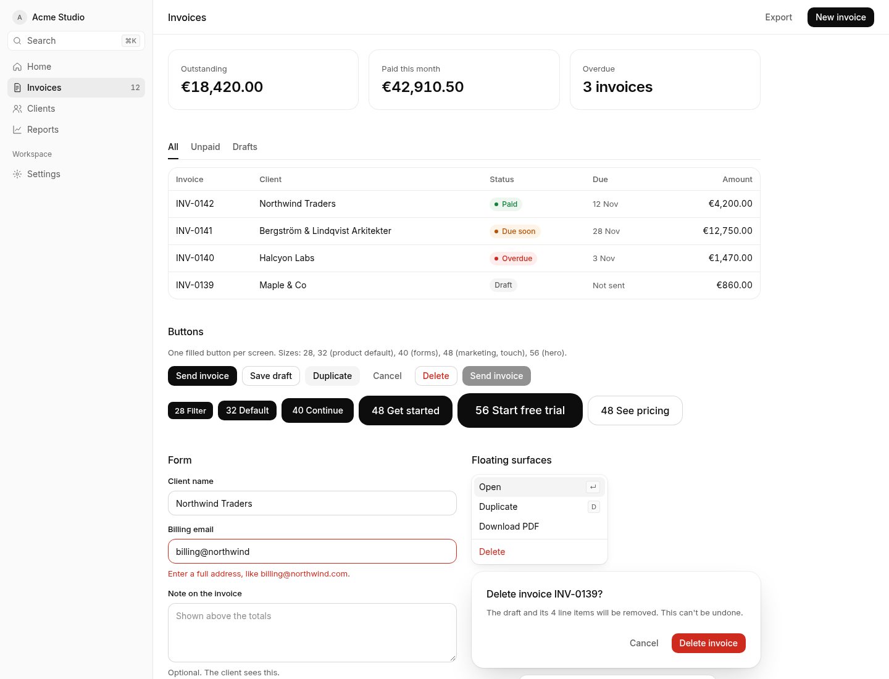
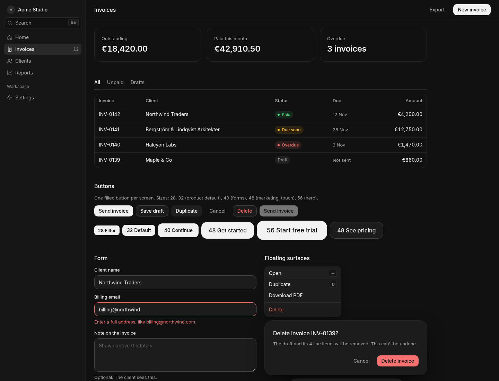
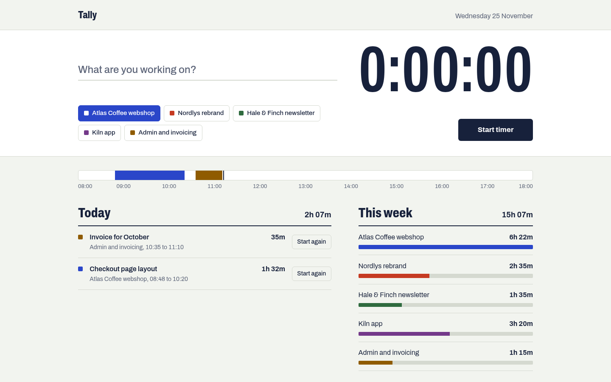
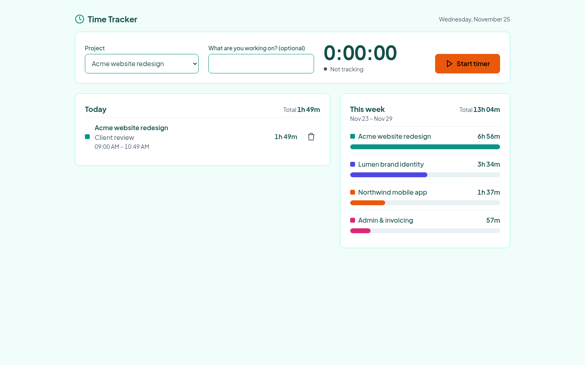
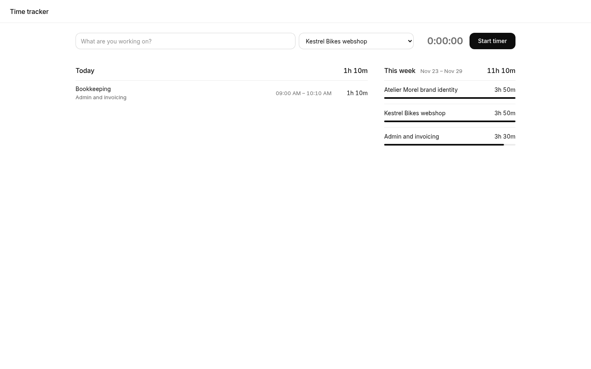

# clear-ui

An agent skill for designing interfaces where the user always knows where they are and what to do
next, and nothing on screen is there for decoration. It works with Claude Code and other agents
that read the `SKILL.md` format.

The skill works in two parts, in this order:

1. **UX.** The agent works out the job of the screen, then shows two or three structurally
   different directions as grayscale wireframes in the chat, with a recommendation. It stops there
   until you choose.
2. **UI.** It applies a fixed visual system to the structure you chose: near-black ink on a white
   page, hairline borders, one filled button per screen, colour only to report status.







## Install

**Claude Code, as a plugin**

```
/plugin marketplace add Cyberoiide/clear-ui
/plugin install clear-ui@clear-ui
```

**Any agent, with the [skills](https://skills.sh) CLI**

```bash
npx skills add Cyberoiide/clear-ui
```

**By hand**

Download `clear-ui.zip` from the [latest release](https://github.com/Cyberoiide/clear-ui/releases/latest)
and unzip it into your skills folder:

```bash
unzip clear-ui.zip -d ~/.claude/skills/
```

The release also carries the same archive as `clear-ui.skill`, for apps that accept a skill file
upload.

## Use

Ask for any interface, or call the skill by name:

```
/clear-ui design the settings page for my invoicing app
```

The agent first replies with wireframes and waits for your choice. To skip that step for a pure
restyling task, say so: "go straight to the UI".

## What is inside

```
skills/clear-ui/
  SKILL.md                  the two-part workflow and the core rules
  references/
    ux.md                   UX method, wireframe rules, rules that keep users oriented, what to avoid
    ui.md                   every token and component specification
    sources.md              what each studied product contributed, and where this system differs
    research/ux/            four behaviour teardowns
    research/ui/            four visual teardowns
  assets/
    tokens.css              all tokens as CSS variables (light and dark) plus reference classes
    components.html         every component on one page
    wireframe.html          grayscale kit for presenting UX directions
```

## The system in short

**UX**

- The user can always tell where they are: selected navigation, breadcrumb, title and URL agree.
- The main task comes first, usable before any signup or choice.
- One primary action per screen; at most two actions per card; rows carry facts, not buttons.
- Ask less: one question per screen in guided flows, defaults filled in, "not now" as a real answer.
- Every action answers back, undo beats confirmation, and typed text is never lost.

**UI**

- Ink `#0d0d0d` on white, three text greys, weights 400, 500 and 600 only.
- Colour means status: green, amber, red, blue. No accent colour by default.
- Borders for what sits on the page; shadows only for what floats above it.
- Buttons and inputs 28, 32, 40, 48 or 56px high, radius about a third of the height.
- A 4px spacing grid; Inter or the system font at 14px.
- Hover appears at once and fades over 150ms; nothing animates on load or scroll.

## Benchmark

One prompt was given to three agents, each following a different skill (`frontend-design`,
`ui-ux-pro-max`, `clear-ui`). First replies, screenshots and counts are in
[benchmark/](benchmark/README.md).

| `frontend-design` | `ui-ux-pro-max` | `clear-ui` |
|---|---|---|
|  |  |  |

## Where it comes from

The rules were derived in November 2026 from the public pages, shipped CSS, documentation and
published design writing of Linear, ChatGPT, Mistral and Alan. No accounts were created, so
logged-in screens were read from official docs and screenshots; each research file states what was
observed live and what was not. The research folders are a snapshot and will age.

This project is independent. It is not affiliated with or endorsed by Linear, OpenAI, Mistral AI or
Alan, and it ships none of their code, fonts or assets. Product names are used only to say where a
pattern was observed.

It was inspired by two existing skills: Anthropic's `frontend-design` and
[clean-ui-design](https://github.com/theophile-wallez/clean-ui-design) by theophile-wallez.

## Releasing

Bump `version` in `.claude-plugin/plugin.json`, commit, then push a matching tag:

```bash
git tag v1.0.1 && git push origin v1.0.1
```

The release workflow packages `skills/clear-ui` and publishes it as a GitHub release.

## License

MIT
