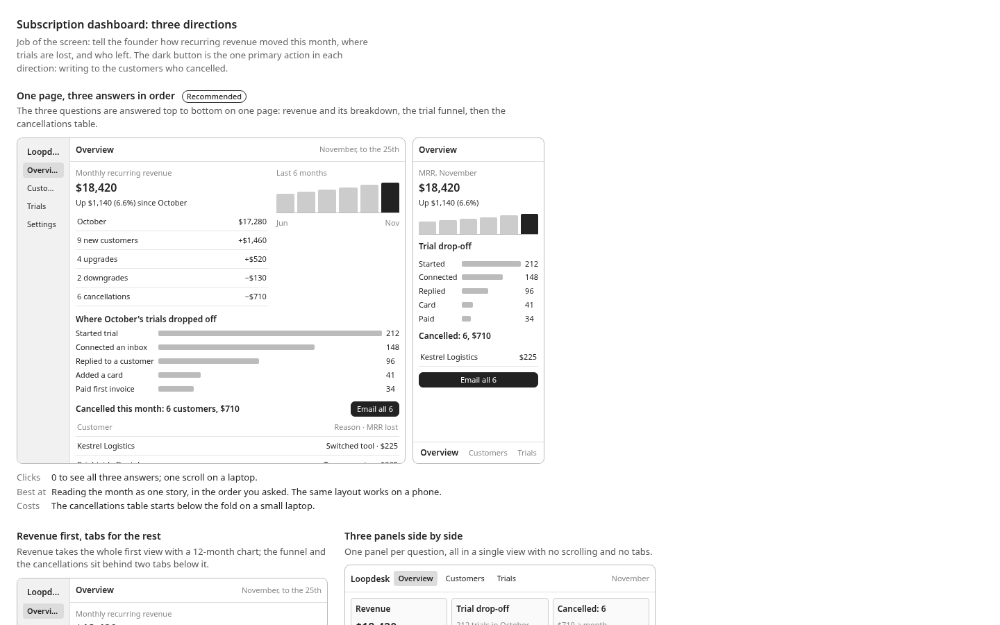
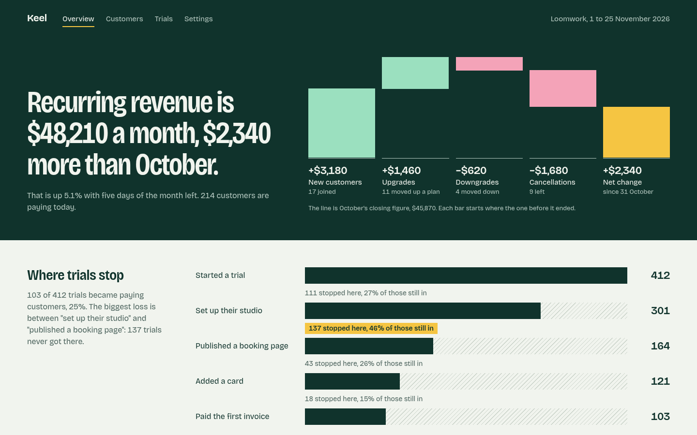
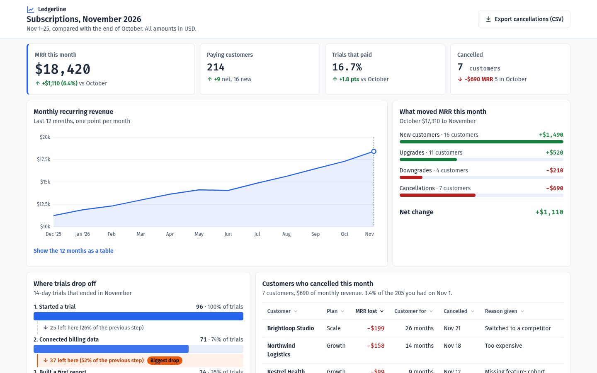
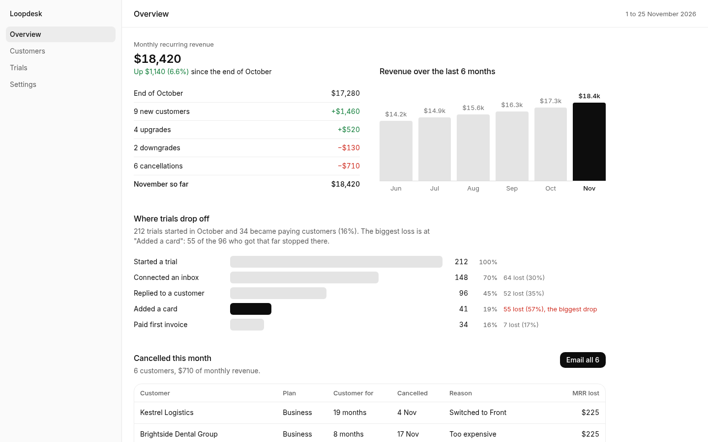
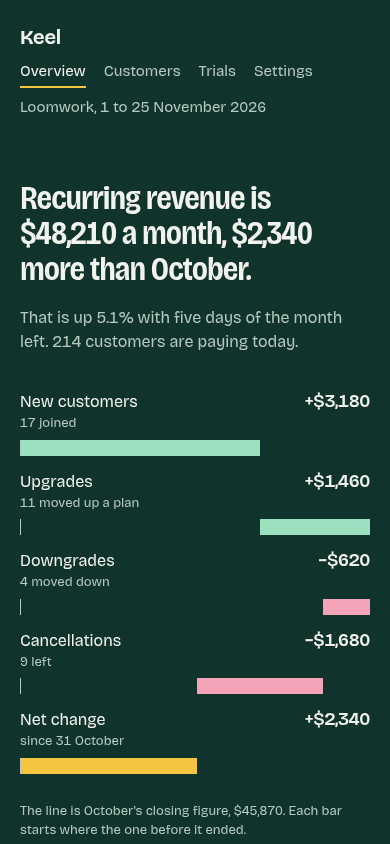
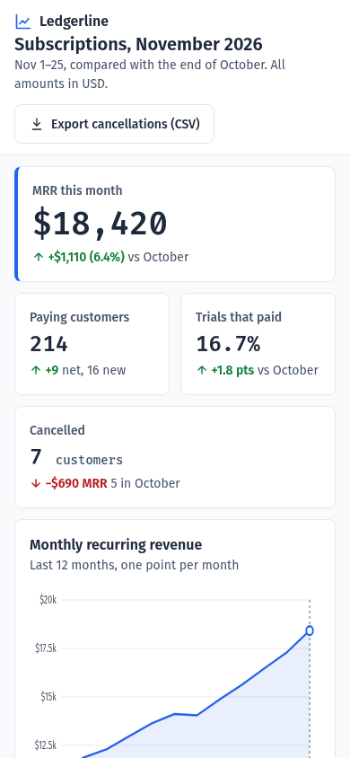
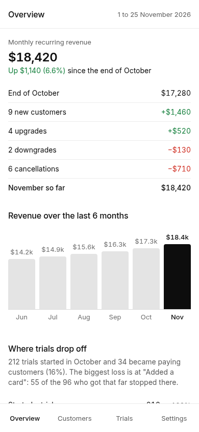

# Benchmark 2: a dashboard, three skills

Second run, on 25 November 2026, with `clear-ui` 1.1.0. Same method as the [first benchmark](../README.md):
one prompt, three agents, each following one skill without seeing the others.

Read it as an illustration, not a ranking: one prompt, one run per skill, set up by the author of
`clear-ui`. The prompt is a dashboard because `clear-ui` 1.1.0 added rules for charts, so this is
the case that version was written for.

## The prompt

> Build the main dashboard of a subscription analytics app for a small SaaS founder. I need to see
> this month's recurring revenue and how it changed, where trial signups drop off before they pay,
> and which customers cancelled this month. One self-contained index.html, no build step.

| Skill | Version |
|---|---|
| `frontend-design` (Anthropic) | 1.1.1 |
| `ui-ux-pro-max` | 2.15.0 |
| `clear-ui` | 1.1.0 |

## The first reply

| | What the user gets first | Full text |
|---|---|---|
| `frontend-design` | The finished page, with a design plan (colours, typeface, a text wireframe) | [first-reply.md](runs/frontend-design/first-reply.md) |
| `ui-ux-pro-max` | The finished page, with the design system it looked up. Its first lookup returned a glass-style landing page; the agent searched again and used a dashboard match. | [first-reply.md](runs/ui-ux-pro-max/first-reply.md) |
| `clear-ui` | Three directions as wireframes with the charts drawn in them, a recommendation and a question. No UI yet. | [first-reply.md](runs/clear-ui/first-reply.md) |



## The finished screens

Desktop, 1440 × 900:

| `frontend-design` | `ui-ux-pro-max` | `clear-ui` |
|---|---|---|
|  |  |  |

Phone, 390 × 844:

| `frontend-design` | `ui-ux-pro-max` | `clear-ui` |
|---|---|---|
|  |  |  |

The pages: [frontend-design](runs/frontend-design/index.html),
[ui-ux-pro-max](runs/ui-ux-pro-max/index.html), [clear-ui](runs/clear-ui/index.html).

## Counts

Measured by [`measure.js`](../measure.js); raw output in [`metrics.json`](metrics.json).

| | `frontend-design` | `ui-ux-pro-max` | `clear-ui` |
|---|---|---|---|
| Colour hues on screen (greys excluded) | 3 | 4 | 2 |
| Font families | 1 | 2 | 1 |
| Font sizes | 8 | 7 | 4 |
| Font weights | 3 | 4 | 3 |
| Corner radii | 1 | 4 | 5 |
| Filled buttons | 1 | 0 | 1 |
| Gradients | 5 | 0 | 0 |
| Shadows, animations | 0 | 0 | 0 |
| Text under 4.5:1 contrast | 0 | 0 | 0 |
| Visible elements | 169 | 336 | 158 |
| Words | 354 | 354 | 228 |
| Page size | 16.1 KB | 23.0 KB | 14.7 KB |

The five "gradients" in `frontend-design` are the hatched part of its funnel bars, drawn with a
striped CSS gradient, not decorative fades. The two hues in `clear-ui` are the green and red of the
revenue changes. Each page invented its own sample data.

## What the screens show

- **All three drew the data.** Each has a funnel of labelled bars with the biggest drop marked, and
  a table of cancelled customers. Unlike the first benchmark, `clear-ui` did not fall back to rows.
- **Revenue.** `frontend-design` states it as a sentence and draws a bridge from October to now,
  which explains the change best. `ui-ux-pro-max` shows a 12-month line plus bars for what moved.
  `clear-ui` shows the number, a breakdown that adds up, and six columns with November in ink.
- **Density.** `ui-ux-pro-max` has about twice the elements of the others: four stat cards, cards
  around everything, sortable columns and a CSV export. It shows the most and takes longest to read.
- **Character.** `frontend-design` is the only one with a point of view: a dark green band, a
  condensed headline, hatched bars. `clear-ui` is black, white and grey, with colour only on the
  changes.
- **Weak points of `clear-ui` here.** It invented an "Email all 6" button because the skill asked
  for one filled button, on a screen that is only read. The page stops at 1232px and leaves the
  right of a wide screen empty. Its table cannot be sorted. Version 1.1.1 changes the button rule.
- **Weak points of the others.** `frontend-design` needs a scroll before the cancellations appear
  and gives half the first view to one number. `ui-ux-pro-max` uses blue, green, red and orange
  together, and its funnel and table are cut by the fold.

## Limits

The same as the first benchmark: one run each, subagents told to follow a skill file, the
`clear-ui` choice of direction simulated, and behaviour (sorting, export, the email link) not
tested here.

## Run it again

```bash
CHROME=/path/to/chrome benchmark/run.sh benchmark/2-dashboard
```
