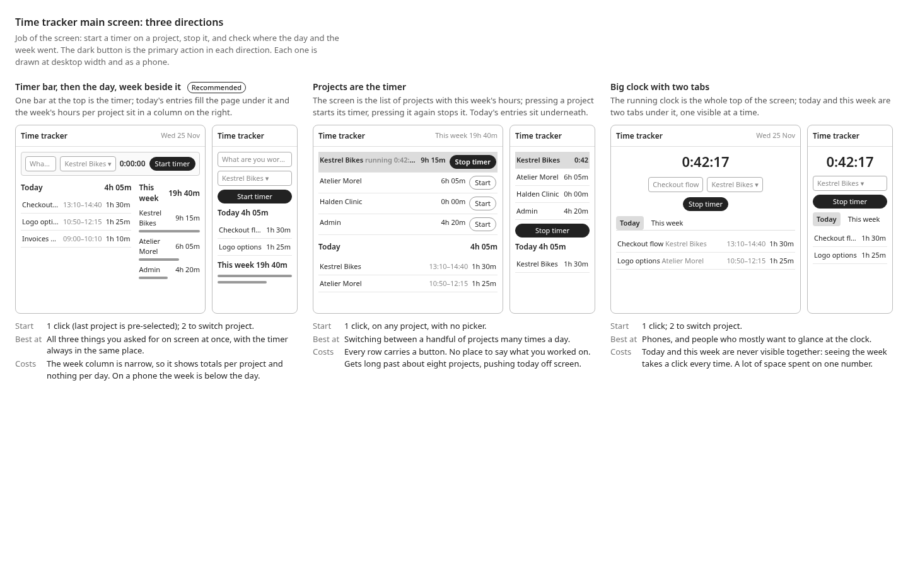
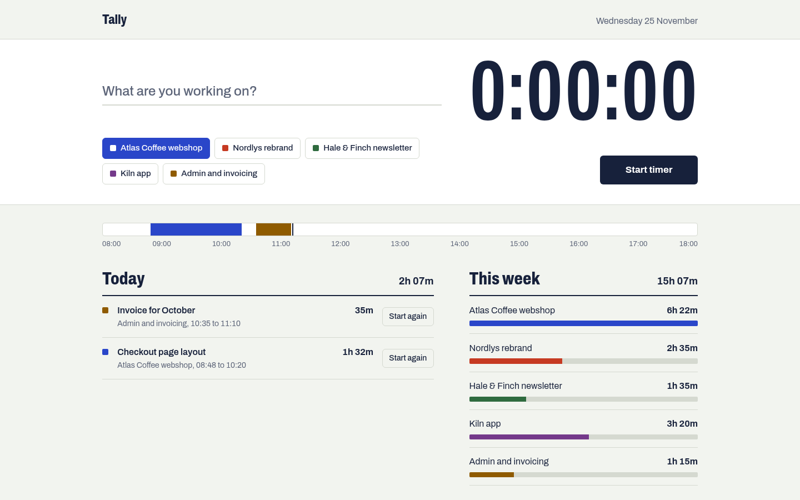
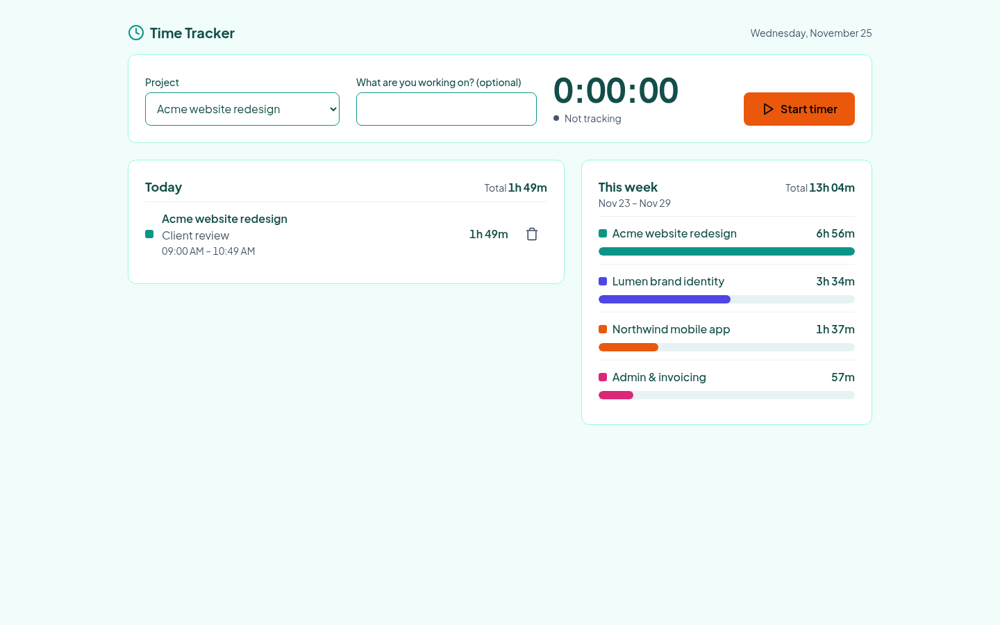
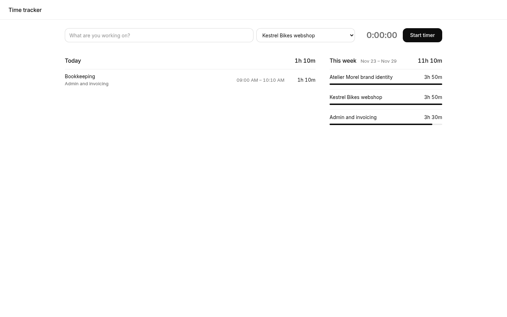
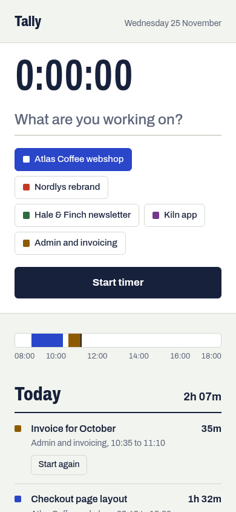
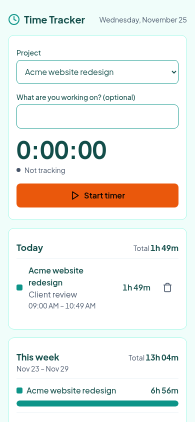
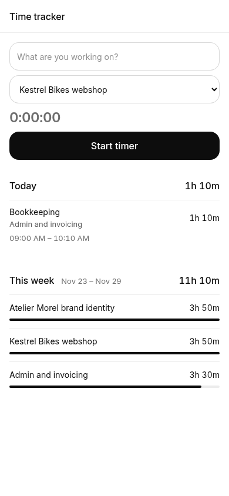

# Benchmark: one prompt, three skills

The same prompt was given to three agents on 25 November 2026. Each followed one skill and could
not see the others' work. This page shows what each one produced first, and what the finished
screens look like.

It is one prompt and one run per skill, so read it as an illustration, not as a ranking. It was also
set up by the author of `clear-ui`, and several of the counts below measure exactly what `clear-ui`
is built to minimise.

## The prompt

> Build the main screen of a time-tracking web app for freelancers. I need to start and stop a
> timer on a project, see today's entries, and see this week's hours per project. One
> self-contained index.html, no build step.

| Skill | Version |
|---|---|
| `frontend-design` (Anthropic) | 1.1.1 |
| `ui-ux-pro-max` | 2.15.0 |
| `clear-ui` | 1.0.0 |

Each agent was told to read its skill and everything the skill points to, run the skill's scripts,
and save its first reply and the finished page. If a skill said to stop and wait for the user, the
agent saved that reply, then continued as if the user had answered "Go with what you recommend".

## The first reply

| | What the user gets first | Full text |
|---|---|---|
| `frontend-design` | The finished screen, with a short design plan | [first-reply.md](runs/frontend-design/first-reply.md) |
| `ui-ux-pro-max` | The finished screen, with the design system it looked up | [first-reply.md](runs/ui-ux-pro-max/first-reply.md) |
| `clear-ui` | Three structural directions as wireframes, a recommendation, and a question. No UI yet. | [first-reply.md](runs/clear-ui/first-reply.md) |

The `clear-ui` first reply, as rendered:



So `clear-ui` costs one extra exchange before any screen exists. The other two deliver in one.

## The finished screens

Desktop, 1440 × 900:

| `frontend-design` | `ui-ux-pro-max` | `clear-ui` |
|---|---|---|
|  |  |  |

Phone, 390 × 844:

| `frontend-design` | `ui-ux-pro-max` | `clear-ui` |
|---|---|---|
|  |  |  |

The pages themselves: [frontend-design](runs/frontend-design/index.html),
[ui-ux-pro-max](runs/ui-ux-pro-max/index.html), [clear-ui](runs/clear-ui/index.html).

## Counts

Measured on the rendered desktop page by [`measure.js`](measure.js); raw output in
[`metrics.json`](metrics.json).

| | `frontend-design` | `ui-ux-pro-max` | `clear-ui` |
|---|---|---|---|
| Colour hues on screen (greys excluded) | 5 | 5 | 0 |
| Font sizes | 9 | 5 | 4 |
| Font weights | 5 | 4 | 3 |
| Corner radii | 4 | 5 | 2 |
| Filled buttons | 1 | 1 | 1 |
| Gradients, shadows, animations | 0 | 0 | 0 |
| Text under 4.5:1 contrast | 0 | 0 | 0 |
| Visible elements | 104 | 82 | 44 |
| Words | 94 | 80 | 60 |
| Page size | 16.3 KB | 21.6 KB | 16.7 KB |

Each page fills itself with its own sample data on first open, and the amounts differ (five
projects, four, and three), so part of the gap in elements and words is sample data, not design.

## What the screens show

- **Colour.** The other two give every project its own colour, and `ui-ux-pro-max` adds a mint
  page and an orange button. `clear-ui` uses none, as intended. The cost: its three week bars look
  identical, and nothing ties an entry to its project except the name.
- **Type.** `frontend-design` chose a condensed display face and a very large clock, which gives
  the page the most character and the most sizes. `clear-ui` shows the clock at 24px in grey.
- **Features.** `frontend-design` added a timeline of the day and "Start again" on each entry.
  `ui-ux-pro-max` added delete with undo. `clear-ui` built only what was asked: an entry started
  by mistake cannot be removed.
- **Structure.** All three ended with the same layout: timer on top, today on the left, the week
  on the right. The wireframe step did not lead to a different structure here; what it added is
  that the user would have chosen it.
- **None of the three** produced gradients, card shadows, low-contrast text or load animations.

## Limits

- One prompt, one run each. Another run of the same skill would differ.
- The agents were subagents told to follow a skill file, not separate sessions where the skill
  triggered by itself.
- The `clear-ui` user choice was simulated.
- Behaviour (starting, stopping, reloading) was checked only by each agent on its own page, not
  compared here.
- `measure.js` reads solid background colours only, and counts a hue once per 30° of the colour
  wheel.

## Run it again

```bash
CHROME=/path/to/chrome benchmark/run.sh
```

It screenshots and measures every folder in `benchmark/runs/` that holds an `index.html`.
